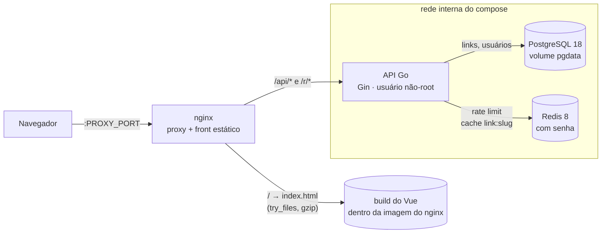
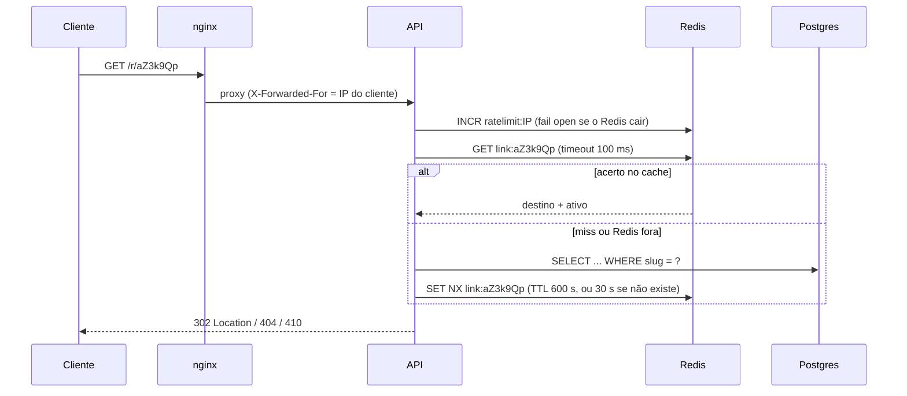

# URL Shortner

Encurtador de URLs com API em **Go (Gin + GORM)**, front em **Vue 3 (Vite + Tailwind)**, **PostgreSQL**, **Redis** e **nginx**, tudo em Docker Compose.

Autor: svitorz · Licença: MIT

- O usuário cria uma conta, encurta URLs (`http://localhost/r/aZ3k9Qp`), lista e desativa os próprios links.
- O redirect é público e usa cache no Redis.
- Há testes de integração com Postgres real, CI no GitHub Actions e um teste de carga com os números medidos (abaixo, com o método).

## Arquitetura



Como uma requisição a `GET /r/<código>` é atendida:



- **Portas:** só o nginx fica exposto. Postgres e Redis não publicam porta no host, e a API é publicada apenas em `127.0.0.1`, para depuração.
- **Front:** o build do Vue é feito dentro da imagem do nginx, então front e API ficam na mesma origem e não há CORS.

## Como rodar

Requisitos: Docker com Compose v2.17 ou mais novo (o build usa `additional_contexts`). Os scripts de verificação também usam `curl` e `jq`.

```bash
cp .env.example .env
```

Preencha no `.env` as três variáveis obrigatórias, que ficam vazias de propósito:

| Variável | Como gerar |
|---|---|
| `DB_PASSWORD` | `openssl rand -hex 16` |
| `REDIS_PASSWORD` | `openssl rand -hex 16` |
| `API_KEY` (mín. 32 bytes) | `openssl rand -hex 32` |

Se a porta 80 estiver ocupada, troque `PROXY_PORT` e coloque a mesma porta em `PUBLIC_BASE_URL` (ex.: `PROXY_PORT=8088` e `PUBLIC_BASE_URL=http://localhost:8088`).

```bash
docker compose up -d --build
```

Abra `http://localhost` (ou a porta escolhida). Sem as senhas, o compose recusa subir com uma mensagem clara; a API também recusa iniciar com `API_KEY` vazia ou curta.

Os dados do Postgres ficam no volume `pgdata` e sobrevivem a `docker compose down` e `up`. Atenção: `down -v` apaga o volume.

### Verificar

```bash
PROXY_PORT=80 scripts/smoke.sh
```

```bash
scripts/infra-check.sh
```

```bash
scripts/test.sh
```

- **`smoke.sh`:** 43 verificações de ponta a ponta pelo nginx, incluindo reiniciar a API e checar se os dados persistiram.
- **`infra-check.sh`:** confere portas, healthchecks, usuário não-root e senhas obrigatórias.
- **`test.sh`:** roda gofmt, vet e os testes Go com um Postgres 18 descartável.

### Desenvolvimento do front (com HMR)

O front de desenvolvimento também roda no compose, com a mesma imagem `node:24-alpine` do build. Assim a versão do Node é a mesma em qualquer máquina e nada precisa ser instalado no host:

```bash
docker compose --profile dev up -d
```

- **Onde abrir:** `http://localhost:5173` (ou a porta definida em `WEB_DEV_PORT`). A porta é publicada só no loopback.
- **Edição:** as mudanças em `web/` aparecem na hora (HMR), sem rebuild.
- **API:** o Vite encaminha `/api` e `/r` para a API dentro da rede do compose.
- **Dependências:** o `node_modules` fica no volume `web_node_modules`, e a cada subida o `npm ci` o sincroniza com o `package-lock.json`. Depois de mudar dependências, basta reiniciar o serviço: `docker compose --profile dev restart web-dev`.
- **Sem o profile:** `docker compose up` sobe só o front de produção, servido pelo nginx.

O Docker cria uma pasta `web/node_modules` vazia, do root, no host: é o ponto de montagem do volume, e o git a ignora. Se algum dia quiser rodar `npm` direto no host, apague essa pasta antes.

Para lint e build do front sem Node instalado:

```bash
docker compose --profile dev run --rm --no-deps web-dev sh -c "npm ci && npx eslint . && npx vite build --outDir /tmp/dist --emptyOutDir"
```

## Variáveis de ambiente

| Variável | Obrigatória | Padrão no exemplo | Para quê |
|---|---|---|---|
| `DB_NAME`, `DB_HOST`, `DB_PORT`, `DB_USER` | sim | `shortner`, `db`, `5432`, `postgres` | conexão com o Postgres (`db` é o nome do serviço) |
| `DB_PASSWORD` | **sim** | vazio | senha do Postgres |
| `DB_MAX_CONNS` | não | 20 | tamanho do pool (conexões abertas = conexões ociosas) |
| `APP_PORT` | sim | 8000 | porta da API na rede do compose |
| `PROXY_PORT` | não | 80 | porta do nginx no host |
| `PUBLIC_BASE_URL` | sim | `http://localhost` | origem das URLs curtas devolvidas pela API |
| `REDIS_HOST`, `REDIS_PORT`, `REDIS_DB`, `REDIS_PROTOCOL` | sim | `redis`, 6379, 0, 2 | conexão com o Redis |
| `REDIS_PASSWORD` | **sim** | vazio | senha do Redis (`requirepass`) |
| `TRUSTED_PROXIES` | não | faixas privadas | IPs/CIDRs dos quais o `X-Forwarded-For` é aceito |
| `REQUISITION_LIMIT`, `MINUTES_OF_DURATION` | sim | 1000, 1 | rate limit por IP (requisições por janela de N minutos) |
| `LINK_CACHE_TTL_SECONDS`, `LINK_CACHE_NEGATIVE_TTL_SECONDS` | não | 600, 30 | TTL do cache do redirect |
| `HASH_COST` | sim | 14 | custo do bcrypt (cerca de 1 s por hash nesta máquina) |
| `API_KEY` | **sim** | vazio | segredo HS256 dos JWT (mínimo 32 bytes) |
| `TOKEN_LIFE_SPAN` | sim | 60 | validade do token, **em minutos** |
| `VITE_API_BASE` | não | `/api` | base da API usada no build do front |
| `WEB_DEV_PORT` | não | 5173 | porta no host do front de desenvolvimento (`--profile dev`) |

Não coloque comentário na mesma linha de um valor: o Compose lê `CHAVE=   # texto` como se o valor fosse `# texto`.

## Rotas

| Método | Caminho | Auth | Resposta de sucesso |
|---|---|---|---|
| GET | `/api/ping` | — | 200 `{"message":"pong"}` |
| POST | `/api/user` | — | 201 `{message, token}` |
| POST | `/api/login` | — | 200 `{token}` |
| PUT | `/api/user/:id` | Bearer | 200 (só o próprio usuário; outro → 403) |
| DELETE | `/api/user/:id` | Bearer | 200 (os links do usuário vão junto) |
| GET | `/api/links` | Bearer | 200 `{links: [...]}` (só os do usuário) |
| POST | `/api/links` | Bearer | 201 `{id, slug, url, owner}` |
| GET | `/api/links/:slug` | Bearer | 200 `{link}` (link de outro usuário → 404) |
| POST | `/api/links/:slug/deactivate` | Bearer | 200 (sem rota para reativar) |
| GET | `/r/:slug` | — | **302** para o destino; 404 se não existe; 410 se desativado |
| GET | `/healthz` | — | 200/503 conforme o Postgres responde; só na rede interna |

Status de erro, corpos e regras de validação estão em [`api/docs/API.md`](api/docs/API.md). Há exemplos prontos em `app.http.example`.

## Decisões e trade-offs

O registro completo, com o porquê e as alternativas descartadas, está em [`PROGRESS.md`](PROGRESS.md#log-de-decisões). As principais:

- **Código curto aleatório:** base62 com 7 caracteres via `crypto/rand`, com retry se colidir. Não é um slug derivado da URL, que vazava o destino e colidia entre usuários. Cada criação gera um link novo do próprio usuário.
- **302, não 301:** o navegador guarda o 301 sem prazo, e a desativação não teria efeito para quem já visitou. O custo é que todo acesso passa pelo servidor.
- **`/r/:slug` fora de `/api`:** a URL curta fica curta. Ela é montada a partir de `PUBLIC_BASE_URL` e não do header `Host`, que é controlado pelo cliente.
- **Rate limit em janela fixa no Redis:** `INCR` + `EXPIRE NX` numa transação, com chave por IP. Se o Redis cair, a requisição passa (fail open). O IP real só é lido do `X-Forwarded-For` quando a conexão vem de um proxy confiável, e o nginx sobrescreve esse header em vez de anexar.
- **Cache do redirect (cache-aside):** a leitura preenche com `SET NX`, e as escritas sobrescrevem com o estado novo em vez de apagar a chave. Assim, um leitor atrasado não repõe "ativo" depois de uma desativação. Há cache negativo com TTL curto. Se o Redis ficar lento, a consulta desiste em 100 ms e vai ao banco.
- **Pool do Postgres configurado:** o padrão do `database/sql` (2 conexões ociosas) abria cerca de 374 conexões por segundo sob carga. O ganho veio daí, não do cache (ver resultados).
- **JWT só no header Bearer, só HS256, `exp` obrigatório:** token na query string vai parar em logs e no Referer. A `API_KEY` precisa ter pelo menos 32 bytes.
- **Login sem enumeração:** a mesma resposta e o mesmo tempo para senha errada e e-mail inexistente (bcrypt contra um hash fictício).
- **Sem logout no servidor:** o logout antigo não revogava nada. Revogar de verdade exigiria uma denylist no Redis, que ainda não existe. Por enquanto o token vale até expirar.
- **Usuário excluído apaga os links em cascata no banco** (`ON DELETE CASCADE`).
- **Um único nginx:** serve o front e faz proxy da API. Não há CORS, porque a origem é a mesma.
- **Imagens:** API em alpine com usuário UID 10001 (cerca de 52 MB, eram 2 GB), versões fixas e healthchecks reais.
- **Testes de integração com Postgres real:** cada teste cria o próprio banco. Mocks não pegariam erros de FK e de constraint, como o bug de migração do início do projeto.

## Desempenho medido

Cenário: `loadtest/run.sh` com k6 2.4.0 numa rede interna do compose, batendo em `http://proxy/r/<slug>` (nginx → API → Postgres/Redis) sem seguir o redirect.
- **Carga:** 50 usuários virtuais em loop, 10 s de aquecimento descartados e 60 s medidos, 3 rodadas.
- **Rate limit:** continuou ativo, com teto alto via `loadtest/compose.loadtest.yml`.
- **Validade:** cada rodada só vale se tiver 0 erros, 100% de respostas 302 e nenhum container reiniciado.

Máquina: notebook com Intel i5-1135G7 (4 núcleos, 8 threads), 7,5 GB de RAM, Debian 13, Docker 29.10.0.

Faixa entre as 3 rodadas (sem média):

| | Antes (pool padrão) | Pool configurado | Pool + cache Redis |
|---|---|---|---|
| Requisições/s | 786,4333–969,0167 | 11040,9833–11121,8167 | 13858,4500–15132,9833 |
| p50 (ms) | 20,298566–23,837930 | 3,736550–3,772239 | 2,799386–2,996212 |
| p95 (ms) | 157,975374–211,394075 | 9,067184–9,282503 | 6,531091–7,410544 |
| p99 (ms) | 207,758357–305,585441 | 13,093775–13,431955 | 9,417925–11,139275 |
| Erros | 0 | 0 | 0 |

**Leitura:**
- **Pool:** o maior ganho veio de configurar o pool. Antes, o Postgres ficava em 402% de CPU só abrindo conexões.
- **Cache:** tirou o banco do caminho (Redis com 323.170 acertos e nenhum miss novo numa rodada de diagnóstico) e melhorou todas as métricas. O ganho é menor que o do pool.

**Limitações:**
- **Máquina compartilhada:** gerador de carga, nginx, API, Postgres e Redis rodam no mesmo notebook, junto com containers de outros projetos. Com cache, o maior consumidor de CPU era o próprio k6 (235%).
- **Um único código:** todas as requisições pedem o mesmo link, o melhor caso do cache (100% de acerto). Com muitos códigos acessados de forma espalhada, o ganho seria menor.
- **Sem rede real** entre cliente e servidor.

Os JSONs de cada rodada estão em `loadtest/results/`, e o método completo e o diagnóstico em `PROGRESS.md`.

## Testes e CI

- **Testes Go:** cobrem unidades (gerador de código, validação de URL, JWT, config, rate limiter e cache com miniredis) e integração pelo router real com Postgres. Na integração entram autenticação (sem token, inválido, expirado), posse de links e usuários, redirect 302/404/410, retry de colisão, invalidação do cache e Redis fora do ar.
- **Cobertura:** 80,0% das instruções, medida com `-coverpkg=./internal/...`.
- **CI** (`.github/workflows/ci.yml`): gofmt, `go vet`, `go test` com Postgres 18 como serviço (no CI, um teste de integração sem banco falha em vez de ser pulado), e ESLint mais build do front. Não há deploy.

## Segurança

**O que existe:**
- Senhas com bcrypt, segredos obrigatórios e validados no boot.
- Postgres e Redis sem porta no host; Redis com senha.
- API sem root.
- Logs sem token, senha ou e-mail; o log de acesso não grava a query string e o do GORM não grava os valores do SQL.
- Validação de URL: só http/https e sem credenciais embutidas.
- Rate limit por IP.
- `server_tokens off` e timeouts no nginx.

**O que não existe:**
- **TLS:** localmente tudo é HTTP. Numa VPS, coloque o certificado no nginx (certbot ou um Caddy na frente), redirecione a 80 para a 443 e use `PUBLIC_BASE_URL=https://...`.
- **Cabeçalhos de segurança:** não há CSP nem HSTS.
- **Revogação de token:** não existe.

## Limitações conhecidas

- **Contagem de cliques:** não existe; a ideia, com os trade-offs, está em `PROGRESS.md` ("Ideias futuras").
- **Token de usuário excluído:** continua aceito até expirar.
- **Dados do usuário logado:** não há `GET /me`, então a tela "Minha conta" começa vazia.
- **Inconsistências do login:** responde 400 (não 422) para corpo inválido, e a falha ao gerar o token responde 400 em vez de 500.
- **Rate limiter com Redis travado:** sem o timeout curto que o cache tem, cada requisição espera até 3 s antes de passar.
- **Rate limit global:** conta também o redirect e o `/healthz`.

## Estrutura

```
api/                 API Go (main.go, internal/, docs/API.md, Dockerfile)
  internal/apitest   testes de contrato pelo router real
  internal/linkcache cache do redirect
  internal/testdb    um banco Postgres por teste
web/                 front Vue 3 (Vite, Tailwind)
proxy/               Dockerfile do nginx (builda o front) + template de config
loadtest/            k6, runner e resultados
scripts/             smoke.sh, infra-check.sh, test.sh
PROGRESS.md          diário do projeto: fases, decisões, medições
```
